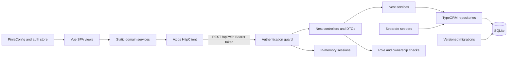
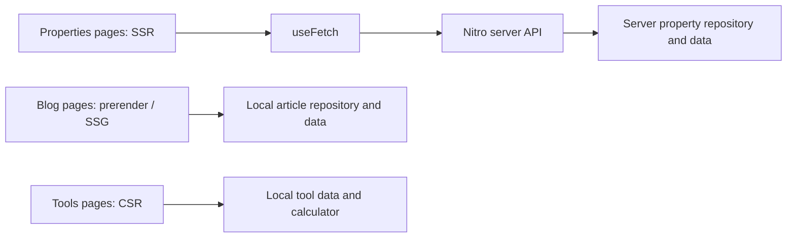
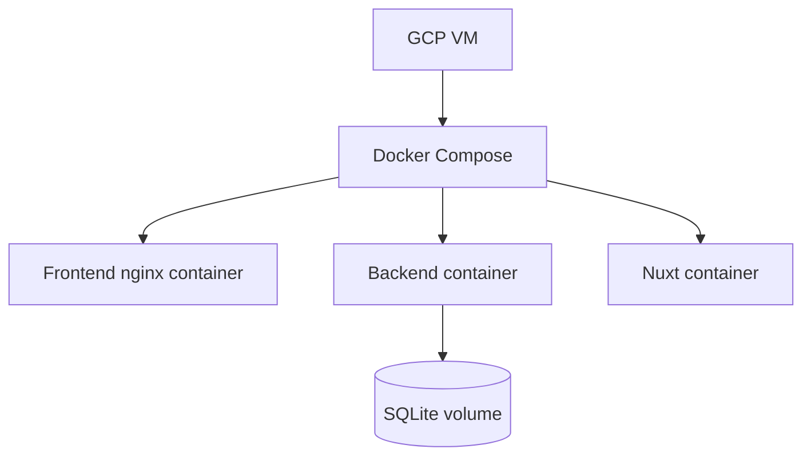

# Architecture

This document describes the current repository structure; deployment must be verified separately. Paths are relative to the repository root.

## SPA and backend



Evidence: `frontend/src/services/property.service.ts:8`, `frontend/src/utils/HttpClient.ts:5`, `backend/src/properties/properties.controller.ts:13`, `backend/src/database/data-source.ts:18`, `backend/src/database/seeders/seed.runner.ts:12`.

The SPA sends an opaque Bearer token to the Nest API. Sessions expire after 12 hours, are revoked on logout, and are held in memory, so restarting the backend invalidates them. Authorization checks use the current user and property ownership from the database. The Nuxt property fixtures and API below are independent of this Nest authentication.

## Nuxt hybrid routes



Blog and tools pages do not use the properties API. Property list and detail pages fetch from the Nuxt server. Prerender configuration sets `crawlLinks: false` and explicitly seeds `/blog` and all three article routes. Evidence: `nuxt/nuxt.config.ts:8`, `nuxt/server/api/properties/index.get.ts:2`, `nuxt/app/pages/blog/index.vue:3`, `nuxt/app/pages/tools/rent-calculator.vue`.

## Deployment configuration



The Compose file configures three services and a SQLite volume; the frontend image uses nginx. The GCP VM is the course deployment target, not a verified running deployment. Image builds and a running deployment require separate verification. Evidence: `docker-compose.yml`, `frontend/Dockerfile`, course requirements.

## Folder responsibilities

```text
frontend/src/             Vue SPA
  views/                  route screens and service calls
  components/             reusable presentation
  router/                 navigation and guards
  services/               domain operations
  utils/                  HTTP and technical helpers
  stores/                 session state and PiniaConfig
  interfaces/ dtos/ enums/  domain and transfer contracts
  assets/ config/         styles and configuration
backend/src/              Nest backend
  users/ properties/ contracts/ transactions/  controllers, services, entities, DTOs
  domain/enums/           shared domain unions
  database/migrations/    versioned schema
  database/seeders/       initial data
nuxt/                     Nuxt hybrid application
  app/pages/              route screens
  app/components/         UI components
  app/layouts/            shared shell
  app/utils/              presentation helpers
  server/api/             Nitro routes
  server/data/            property repository and hardcoded data
  shared/                 shared property interfaces and enums
  tests/e2e/              browser checks
```

Representative source paths: `frontend/src/router/index.ts`, `backend/src/app.module.ts`, `nuxt/server/data/PropertyRepository.ts`, `nuxt/app/data/articles.ts`, `nuxt/app/data/faqs.ts`.
