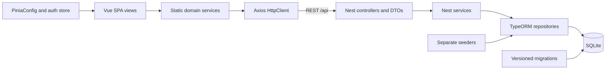
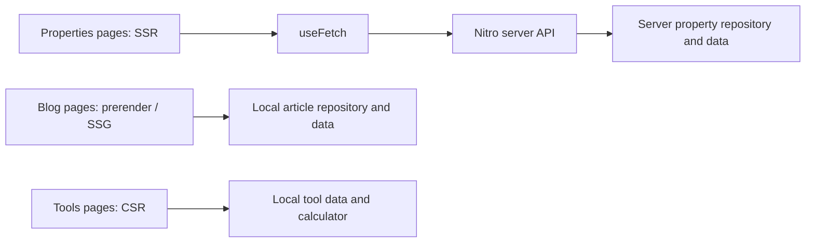
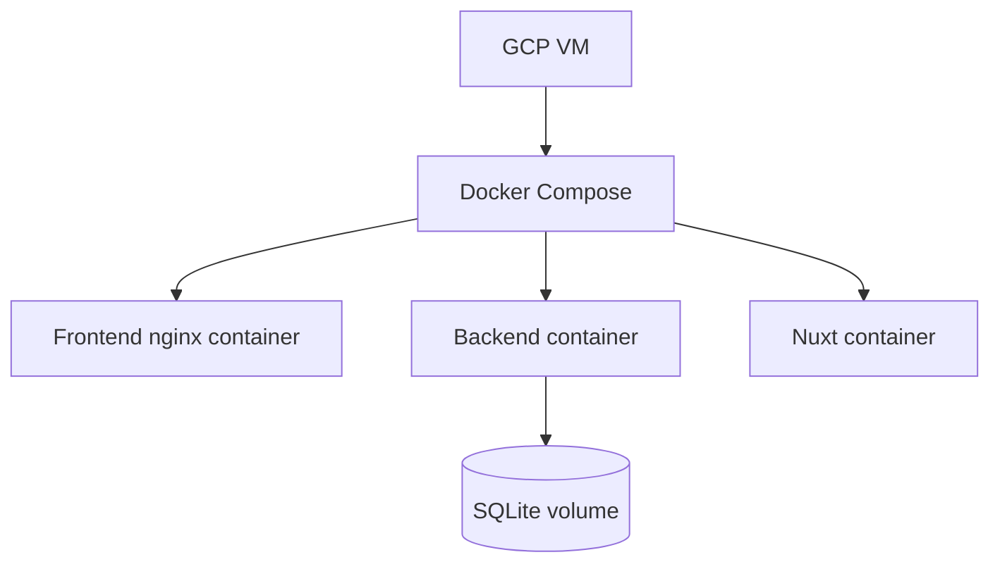

# Architecture

These documents describe the application across development branches; their integration has not been verified. Paths are relative to the repository root.

## SPA and backend



Evidence: `frontend/src/services/property.service.ts:8`, `frontend/src/utils/HttpClient.ts:5`, `backend/src/properties/properties.controller.ts:13`, `backend/src/database/data-source.ts:18`, `backend/src/database/seeders/seed.runner.ts:12`.

## Nuxt hybrid routes



The blog and tools branches provide separate pages; they do not go through the properties API. The properties branch has the route rules but does not yet contain those pages. Prerender configuration sets `crawlLinks: false` and seeds only `/blog`, so static generation of every article is not established. Evidence: `nuxt/nuxt.config.ts:8`, `nuxt/server/api/properties/index.get.ts:2`, `nuxt/app/pages/blog/index.vue:3`, `nuxt/app/pages/tools/rent-calculator.vue`.

## Deployment configuration



The Compose file configures three services and a SQLite volume; the frontend image uses nginx. The GCP VM is the course deployment target, not a verified running deployment. The Compose branch and application branches are separate; integration and image builds have not been verified. Evidence: `docker-compose.yml`, `frontend/Dockerfile`, course requirements.

## Folder responsibilities

```text
frontend/src/             SPA (frontend course-rules branch)
  views/                  route screens and service calls
  components/             reusable presentation
  router/                 navigation and guards
  services/               domain operations
  utils/                  HTTP and technical helpers
  stores/                 session state and PiniaConfig
  interfaces/ dtos/ enums/  domain and transfer contracts
  assets/ config/         styles and configuration
backend/src/              Nest backend (backend course-rules branch)
  users/ properties/ contracts/ transactions/  controllers, services, entities, DTOs
  domain/enums/           shared domain unions
  database/migrations/    versioned schema
  database/seeders/       initial data
nuxt/                     Nuxt properties branch, with separate blog and tools branches
  app/pages/              route screens
  app/components/         UI components
  app/layouts/            shared shell
  app/utils/              presentation helpers
  server/api/             Nitro routes
  server/data/            property repository and hardcoded data
  shared/                 shared property interfaces and enums
  tests/e2e/              browser checks
```

Representative source paths: `frontend/src/router/index.ts`, `backend/src/app.module.ts`, `nuxt/server/data/PropertyRepository.ts`, `nuxt/app/data/articles.ts`, `nuxt/app/data/faqs.ts`.
