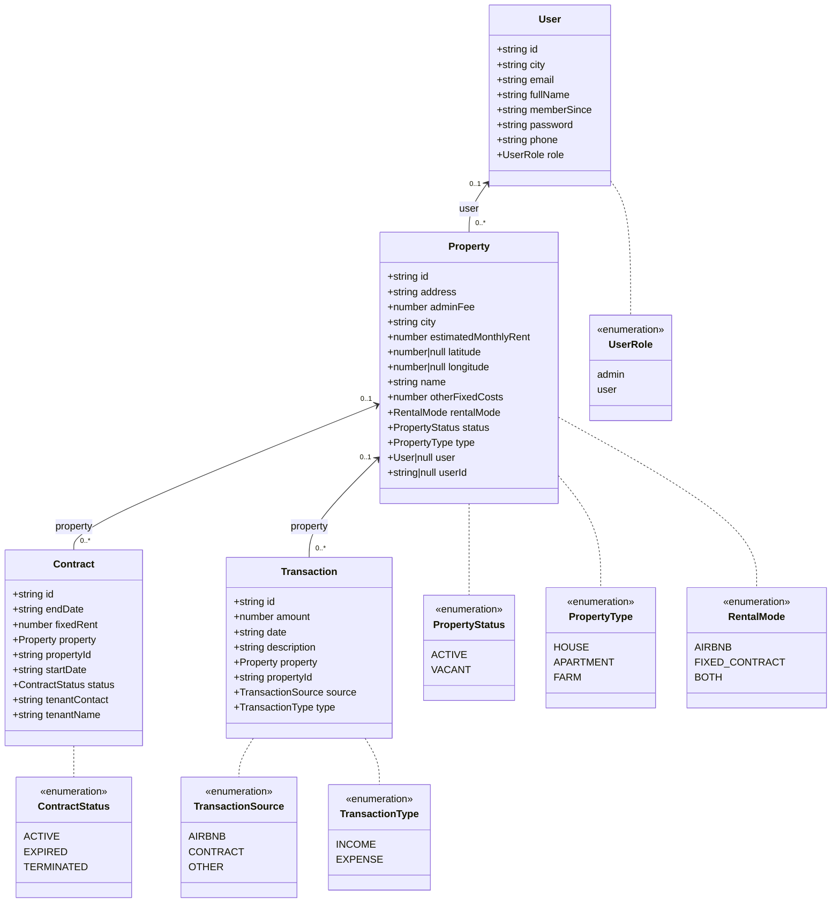

# Domain class diagram

Backend domain types are TypeScript enums, validated in request DTOs with `@IsEnum`. Attributes reflect entity declarations, including nullable columns. Sources: `backend/src/domain/enums`, `backend/src/properties/entities/property.entity.ts`.

Contract and Transaction have owning `ManyToOne` relations and cascading deletes. The migration permits null in each `propertyId`, despite the non-nullable TypeScript annotations; therefore each relation is shown as optional. Property has a nullable `userId` and a unidirectional ManyToOne relation to User with cascading delete; User has no properties collection. Sources: `backend/src/contracts/entities/contract.entity.ts:21`, `backend/src/transactions/entities/transaction.entity.ts:24`, `backend/src/database/migrations/1730000000000-InitialSchema.ts:21`, `backend/src/properties/entities/property.entity.ts:50`, `backend/src/database/migrations/1793595073942-PropertyUserForeignKey.ts`.

| Domain | Backend entity | Backend request DTOs | Frontend interface | Frontend service |
|---|---|---|---|---|
| User | `backend/src/users/entities/user.entity.ts` | `backend/src/users/dto/create-user.dto.ts`, `backend/src/users/dto/update-user.dto.ts` | `frontend/src/interfaces/UserInterface.ts` | `frontend/src/services/user.service.ts` |
| Property | `backend/src/properties/entities/property.entity.ts` | `backend/src/properties/dto/create-property.dto.ts`, `backend/src/properties/dto/update-property.dto.ts` | `frontend/src/interfaces/PropertyInterface.ts` | `frontend/src/services/property.service.ts` |
| Contract | `backend/src/contracts/entities/contract.entity.ts` | `backend/src/contracts/dto/create-contract.dto.ts`, `backend/src/contracts/dto/update-contract.dto.ts` | `frontend/src/interfaces/ContractInterface.ts` | `frontend/src/services/contract.service.ts` |
| Transaction | `backend/src/transactions/entities/transaction.entity.ts` | `backend/src/transactions/dto/create-transaction.dto.ts`, `backend/src/transactions/dto/update-transaction.dto.ts` | `frontend/src/interfaces/TransactionInterface.ts` | `frontend/src/services/transaction.service.ts` |
